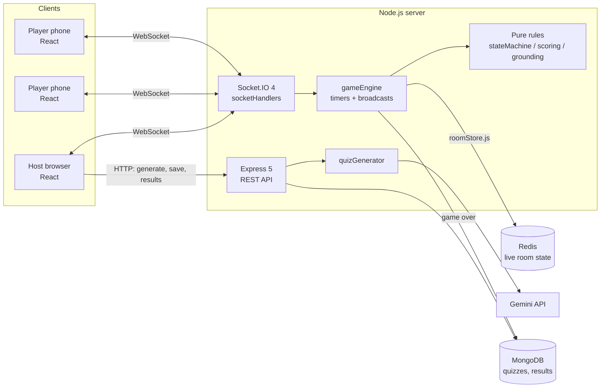
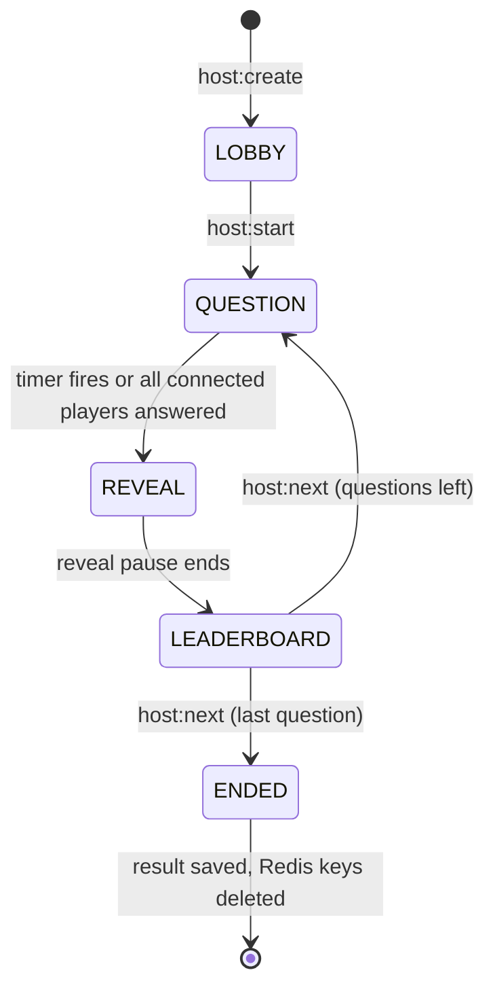

# Buzzroom

A real-time multiplayer quiz platform: a host uploads notes, AI turns them into a multiple-choice quiz, and players join from their phones with a 6-digit code to play live against a shared clock.

## Why this project

Most portfolio apps are request/response CRUD. Buzzroom is about the problems that show up when many clients share **live state**: one authoritative clock, fair timing, atomic writes under concurrency, broadcasts to hundreds of sockets, and players dropping off and coming back mid-game. The server owns every rule; clients only render what they are told and send intents.

## Features

- **AI quiz generation** from a PDF or pasted notes using Gemini structured output, with a grounding check that rejects questions whose evidence is not in the source.
- **Host review** of every question before going live, plus a report of what was generated, what passed validation and grounding, and why the rest was rejected.
- **Live rooms** with 6-digit codes, a projector-friendly lobby, and phone-first player screens.
- **Server-authoritative game loop**: an explicit state machine, server timestamps for scoring, and a countdown that corrects for client clock offset.
- **Speed and streak scoring** with a live top-5 leaderboard backed by a Redis sorted set.
- **Reconnects**: players and the host can refresh or lose signal and resume with their score intact.
- **Results** saved to MongoDB with per-question stats and the hardest question highlighted.
- **Load-test script** that simulates hundreds of players and reports broadcast latency percentiles.

## Tech stack

| Layer | Tech |
| --- | --- |
| Frontend | React 19, Vite, Tailwind CSS 4, react-router-dom, socket.io-client |
| Backend | Node.js 20+, Express 5, Socket.IO 4 |
| Live state | Redis via ioredis (hashes, sorted sets, Lua scripts, TTL) |
| Database | MongoDB + Mongoose |
| AI | Google Gemini via `@google/genai` (JSON schema output) |
| Validation | Zod for HTTP bodies, socket payloads, AI output and env |
| Tests | Vitest (unit + Socket.IO/Redis integration) |

## Architecture



### One question round

1. The host sends `host:next` with its `hostToken`. The handler validates the payload with Zod and checks the room is in `LEADERBOARD`.
2. A Lua script moves the room to `QUESTION` and stores `questionStartedAt = Date.now()` in the same atomic step, so two clicks cannot start two questions.
3. The server broadcasts `question:show` with the text, options, `durationMs` and `serverTime`, never the correct answer, then arms a timer for `durationMs + 300 ms`.
4. Each `player:answer` is stamped with the **server's** receive time, checked against the window, and written with `HSETNX`. A second answer from the same player fails atomically.
5. After every accepted answer the server compares the answer count with the number of connected players. When everyone has answered, or the timer fires, `endQuestion` runs. Both paths race through the same compare-and-set transition, so the question ends exactly once.
6. The server scores every player in one Redis pipeline (`ZINCRBY`, streak and correct-count updates), emits `question:end` with the answer distribution, then sends each player a private `answer:result` with their points and `ZREVRANK` rank.
7. After a short reveal pause the room moves to `LEADERBOARD` and the top 5 (`ZREVRANGE ... WITHSCORES`) is broadcast. The host advances when ready.

## Game state machine



`stateMachine.js` exposes `canTransition(from, to)` and `assertEventAllowed(state, eventName)`. Every socket event is checked against the room's current state before anything else runs, so an answer during `LEADERBOARD` or a join after the game started is rejected with a clear message. The state machine, scoring and grounding modules import nothing from Redis, MongoDB or Socket.IO, which is why they can be unit-tested directly.

### Socket events

| Direction | Event | Payload |
| --- | --- | --- |
| client to server | `host:create` | `{ quizId }`, ack `{ code, hostToken }` |
| client to server | `host:start`, `host:next`, `host:rejoin` | `{ code, hostToken }` |
| client to server | `player:join` | `{ code, nickname }`, ack `{ playerId, playerToken }` |
| client to server | `player:rejoin` | `{ code, playerToken }`, ack with a state snapshot |
| client to server | `player:answer` | `{ code, questionIndex, choice }` |
| client to server | `time:sync` | ack `{ serverNow }` for clock-offset estimation |
| server to client | `lobby:update` | nicknames and count |
| server to client | `question:show` | `{ index, total, text, options, durationMs, serverTime }` |
| server to client | `question:end` | `{ index, correctIndex, answerCounts }` |
| server to client | `answer:result` | private: `{ correct, points, totalScore, rank, ... }` |
| server to client | `leaderboard:update` | top 5 `{ nickname, score }` |
| server to client | `answer:progress` | host only: `{ answered, expected }` |
| server to client | `host:status` | `{ online }` |
| server to client | `game:over` | `{ resultId, podium, ranking }` |
| server to client | `error:game` | `{ message, code }` when no ack callback was given |

## Redis key design

All reads and writes go through `server/src/game/roomStore.js`.

```
room:{code}                  HASH    state, quizId, hostToken, hostSocketId, currentIndex,
                                     questionStartedAt, durationMs, total
room:{code}:claim            STRING  SET NX lock that reserves the room code
room:{code}:quiz             STRING  questions with answers, cached for the game
room:{code}:players          HASH    playerId -> nickname
room:{code}:nicknames        HASH    lowercased nickname -> playerId
room:{code}:tokens           HASH    playerToken -> playerId
room:{code}:online           HASH    playerId -> socketId (present = connected)
room:{code}:lb               ZSET    playerId -> score
room:{code}:streaks          HASH    playerId -> consecutive correct answers
room:{code}:correct          HASH    playerId -> correct answer count
room:{code}:results          HASH    playerId -> last answer result (for reconnects)
room:{code}:stats            HASH    question index -> answer distribution and timing
room:{code}:q:{i}:answers    HASH    playerId -> "choice|elapsedMs"
```

Why these structures:

- **Sorted set for the leaderboard.** Scores change for every player after every question. A sorted set keeps them ordered on write (`ZINCRBY` is O(log n)), so reading the top 5 is `ZREVRANGE 0 4` and any player's rank is a single `ZREVRANK`. The alternative, loading every score into an array and sorting it on each read, costs O(n log n) per request and would run once per player per question.
- **`HSETNX` for one answer per player.** Two taps from a player arrive as two events that can be processed concurrently. A read-then-write check would let both through. `HSETNX` checks and writes in one atomic command, so exactly one answer wins without locks.
- **Lua scripts for multi-step atomic changes.** Joining a room (check state is `LOBBY`, check capacity, reserve the nickname, register the player) and state transitions (compare current state, then set new state and fields) run as scripts. This closes the race between a late join and `host:start`, and lets the "everyone answered" path and the timer path both try to end a question with only one succeeding.
- **Compare-and-delete for presence.** When a player reconnects, the new socket is registered before the old socket's disconnect is processed. Marking the player offline only if the stored socket id still matches prevents a stale disconnect from hiding a live player.
- **TTL on every key (2 hours).** Every write refreshes the TTL of the keys it touches, so abandoned rooms clean themselves up. Finished games delete their keys explicitly after the result is stored in MongoDB.
- **Room codes** are random 6-digit numbers reserved with `SET room:{code}:claim 1 NX EX 7200`, retried on collision.

## Timing, fairness and anti-cheat

- **The server owns the clock.** `questionStartedAt` is set when the question is broadcast, and each answer is timed by the server's receive time. Client timestamps are never trusted, so a modified client cannot claim a faster answer.
- **Answer window.** An answer counts only if `receivedAt <= startedAt + durationMs + 300 ms`. The 300 ms grace absorbs ordinary network jitter so a tap at 0.1 s left is not lost in transit.
- **Scoring** (`scoring.js`): a correct answer earns `round(1000 * (1 - (elapsed / duration) / 2))`, clamped to 500-1000. Consecutive correct answers add a streak bonus of +100 from the second answer in a row, capped at +300. A wrong or missing answer earns 0 and resets the streak.
- **The correct answer never leaves the server** before the question ends. `question:show` and reconnect snapshots strip it.
- **Countdown accuracy.** On connect the client runs three `time:sync` round trips and keeps the sample with the lowest RTT to estimate its clock offset (NTP style). The countdown is drawn from `serverTime + durationMs` on the server's timeline, so a phone with a wrong clock still shows the right number.
- **Known trade-off.** Elapsed time is measured on the server, so it includes both the time for `question:show` to reach the phone and the time for the answer to travel back. A player with a 300 ms round trip is charged about 280 ms more than a player on 20 ms. On a 20-second question that costs about 7 points per correct answer, which can still decide a close game. RTT compensation would fix it: measure each socket's round trip continuously (Socket.IO ping or periodic `time:sync`), subtract the smoothed RTT from the measured elapsed time, and cap the correction. The cap matters because a client could deliberately slow its pings to earn extra time.
- **Host-only actions** require the `hostToken` from `host:create`, compared in constant time. Player identity on reconnect uses an unguessable `playerToken`, not the nickname.

## AI generation pipeline

```
PDF or text -> extract text -> chunk -> Gemini (JSON schema) -> Zod -> grounding check -> de-duplicate -> host review -> save
```

1. **Extract.** PDFs (up to 5 MB, checked by size and by the `%PDF-` signature) are read with pdf-parse. Pasted text is accepted directly. Whitespace is normalised.
2. **Chunk.** Text is split into chunks of up to about 30,000 characters on paragraph or sentence boundaries (maximum 4 chunks). Questions are allocated to chunks in proportion to their length, and about 40% more questions than requested are asked for, because some will be rejected.
3. **Generate.** Each chunk is sent to Gemini with `responseMimeType: "application/json"`, a `responseSchema`, temperature 0.4 and a 20-second `AbortController` timeout. Each question carries `question`, exactly 4 `options`, `correctIndex` and `evidence`, a sentence copied from the source.
4. **Validate.** Zod checks every question: question length 10-200, four non-empty options that are distinct ignoring case, `correctIndex` 0-3.
5. **Ground.** Both the evidence and the source are lowercased, stripped of punctuation and accents, and whitespace-collapsed. The question is rejected if the normalised evidence is not a whole-word substring of the normalised source, if the evidence is too short to prove anything, or if the correct option shares no meaningful word (stopwords removed, light prefix matching for word forms) with the evidence.
6. **De-duplicate.** Questions are dropped if their normalised text matches an earlier one or their token overlap (Jaccard) is at least 0.8.
7. **Shuffle and report.** Options are shuffled so the correct answer is not always in the same slot. The response includes a report `{ generated, passedSchema, passedGrounding, kept, rejected: [{ reason, question }] }`, shown on the Review page.

A missing `GEMINI_API_KEY` returns a clear 503. The generate endpoint is rate-limited to 5 requests per minute per IP.

## Scaling path

A single Node process handles a room end to end. To run several instances:

1. Set `USE_REDIS_ADAPTER=true`. This enables `@socket.io/redis-adapter`, so a broadcast to `room:{code}` reaches sockets connected to any instance.
2. Put the instances behind a load balancer with **sticky sessions** (for example cookie- or IP-based affinity). Socket.IO's HTTP long-polling transport needs every request of a session to reach the same instance.
3. **Timer ownership.** The question timer lives in the memory of the instance that started the question, which is normally the host's instance. All room state is in Redis and every transition is a compare-and-set, so if the "all answered" check fires on another instance first, the question still ends exactly once and the stale timer becomes a no-op. If the owning instance dies mid-question, that timer is lost and the room waits for the host to act again. Moving timers into a shared scheduler (for example a Redis sorted set of deadlines polled by every instance, or BullMQ delayed jobs) would remove that single owner.

## Load testing

`loadtest/bots.js` connects N socket.io clients, joins them to a room, answers a random option after a random delay inside the time limit, and measures:

- **Broadcast latency** for each `question:show`: receive time minus the server's `serverTime`.
- Answer acknowledgement round-trip time.
- Failed joins and rejected answers, grouped by reason.

It prints p50, p95, p99 and max per question and a summary table.

```bash
cd loadtest && npm install

# 1. Start the server and client, create a quiz and click "Host live".
# 2. Note the room code on the lobby screen, then:
npm run loadtest -- --code 482913 --players 50
npm run loadtest -- --code 482913 --players 100
npm run loadtest -- --code 482913 --players 300 --concurrency 50
npm run loadtest -- --code 482913 --players 500 --concurrency 50
# 3. Click "Start game" on the host screen and step through the questions.
```

Use a new room for each run. Run the bots on the same machine as the server, or on machines synced with NTP, because broadcast latency compares two clocks. Options: `--url` (default `http://localhost:4000`), `--code`, `--players` (default 100), `--concurrency` (bots connecting at once, default 25), `--prefix` (nickname prefix).

### Results

Run `npm run loadtest` and fill these in with your own measurements.

| Players | Failed joins | Rejected answers | p50 (ms) | p95 (ms) | p99 (ms) | Max (ms) |
| --- | --- | --- | --- | --- | --- | --- |
| 50 | | | | | | |
| 100 | | | | | | |
| 300 | | | | | | |
| 500 | | | | | | |

Machine:

## Local setup

Requirements: Node.js 20 or newer, Docker (for MongoDB and Redis), and a Gemini API key for quiz generation.

```bash
# 1. Start MongoDB and Redis
docker compose up -d

# 2. Server
cd server
cp .env.example .env        # then set GEMINI_API_KEY
npm install
npm run dev                 # http://localhost:4000

# 3. Client (new terminal)
cd client
cp .env.example .env
npm install
npm run dev                 # http://localhost:5173
```

Open `http://localhost:5173/host` to create a quiz. Players open `http://<your-LAN-IP>:5173` on their phones; the Vite dev server listens on all interfaces and proxies `/api` and `/socket.io` to the backend.

From the repository root, `npm run install:all`, `npm test`, `npm run lint` and `npm run build` run the same commands across packages.

### Server environment variables

| Variable | Default | Purpose |
| --- | --- | --- |
| `PORT` | `4000` | HTTP and Socket.IO port |
| `MONGO_URI` | `mongodb://127.0.0.1:27017/buzzroom` | MongoDB connection |
| `REDIS_URL` | `redis://127.0.0.1:6379` | Redis connection |
| `CORS_ORIGIN` | `http://localhost:5173` | Comma-separated allowed origins |
| `GEMINI_API_KEY` | empty | Required for quiz generation |
| `GEMINI_MODEL` | `gemini-2.5-flash-lite` | Any Gemini model that supports JSON schema output |
| `GEMINI_TIMEOUT_MS` | `20000` | Per-request timeout |
| `USE_REDIS_ADAPTER` | `false` | Share rooms across multiple server instances |
| `ROOM_TTL_SECONDS` | `7200` | TTL applied to every room key |
| `REVEAL_MS` | `4000` | How long the answer distribution shows before the leaderboard |
| `GENERATE_RATE_LIMIT` | `5` | Generate requests per minute per IP |
| `LOG_LEVEL` | `info` | `debug`, `info`, `warn` or `error` |

Configuration is validated with Zod on startup; an invalid value stops the server with a clear message.

### Client environment variables

| Variable | Default | Purpose |
| --- | --- | --- |
| `VITE_SERVER_URL` | empty (same origin) | Backend URL when the client is not served through the dev proxy |
| `VITE_DEV_PROXY_TARGET` | `http://localhost:4000` | Where the Vite dev and preview servers proxy API and socket traffic |

### Tests

```bash
cd server
npm test
```

The unit tests cover scoring, state transitions, grounding, chunking, the rate limiter and every Zod schema. `tests/gameEngine.integration.test.js` runs full games through a real Socket.IO server and Redis (database 15 by default, override with `TEST_REDIS_URL`); it is skipped automatically when Redis is not reachable.

## Project structure

```
buzzroom/
  client/                 React (Vite) app
    src/api/              fetch helpers
    src/hooks/useSocket.js  shared connection, reconnect and rejoin logic
    src/pages/host/       Create, Review, Lobby, HostGame, Results
    src/pages/player/     Join, PlayerGame
    src/components/       Countdown, OptionButton, Leaderboard, Podium, ...
  server/
    src/app.js            Express app
    src/server.js         HTTP + Socket.IO bootstrap, graceful shutdown
    src/config/           env validation, Mongo, Redis
    src/game/             stateMachine, scoring, stats (pure), roomStore, gameEngine, socketHandlers
    src/services/         quizGenerator, grounding, textChunks (pure), repositories
    src/validation/       Zod schemas
    tests/                Vitest suites
  loadtest/bots.js        simulated players
  docker-compose.yml      MongoDB + Redis
```

## Known limitations

- **No host accounts.** Anyone with a quiz id can host it, and the host is identified only by the `hostToken` in their browser's local storage.
- **In-memory rate limiting.** The generate limiter lives in process memory, so it resets on restart and is per instance. A Redis-backed limiter would be needed behind a load balancer.
- **Single timer owner per room.** See the scaling section: if the instance that owns a room's timer crashes mid-question, the question does not end until the host acts.
- **Host disconnect pauses between questions, not mid-question.** A question already running finishes on its timer so players who answered are not penalised. The game then waits at the leaderboard until the host rejoins.
- **Grounding is lexical.** It proves the evidence sentence exists and overlaps with the answer, not that the answer is semantically correct. If the evidence mentions several options (for example "absorbs blue and red, reflects green"), a wrong answer can still pass, which is why the host review step exists.
- **Scanned PDFs** without a text layer produce no text and are rejected; there is no OCR.
- **Ties** in score are ranked by Redis sorted-set order rather than shared ranks.
